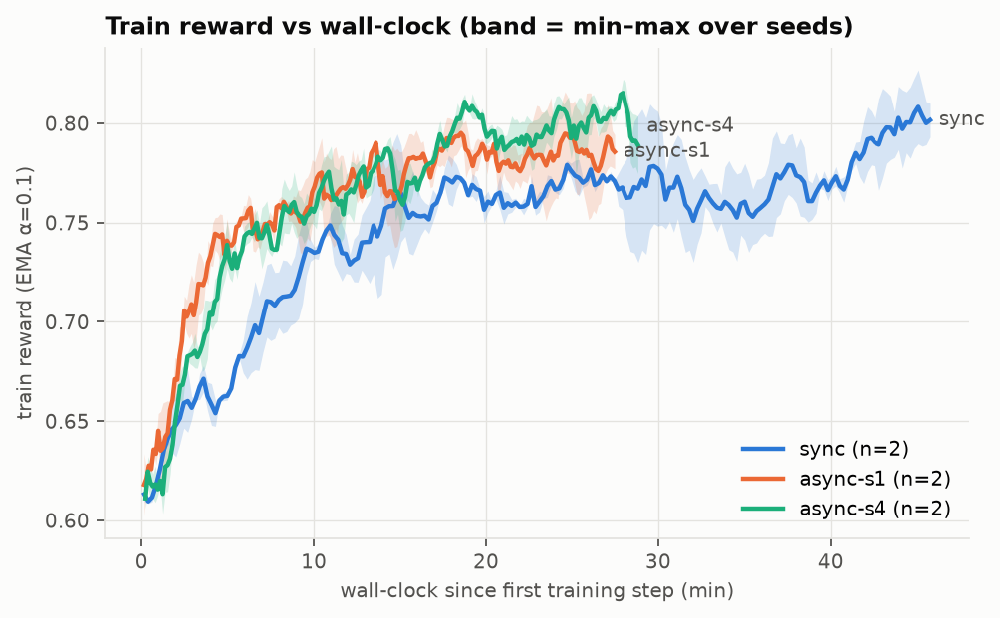
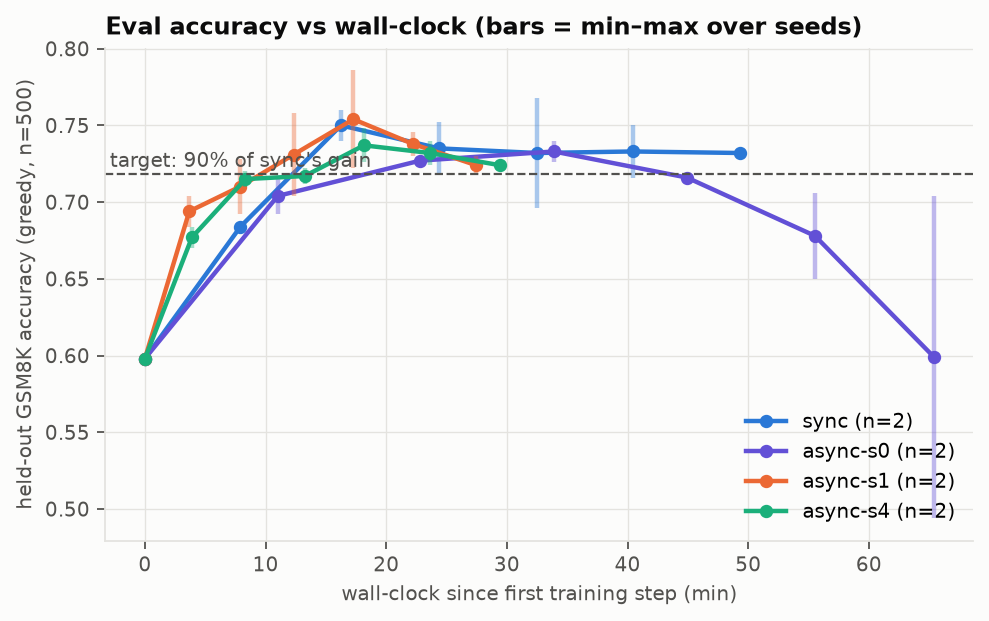
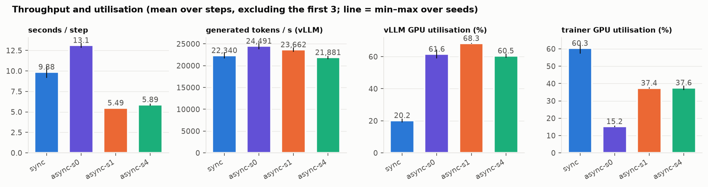

# Async GRPO vs sync GRPO, and what staleness buys

**Async GRPO matched sync GRPO's held-out GSM8K accuracy (0.724 vs 0.732, s.e. ±0.020) and finished the same
300 steps in ~40% less wall-clock (28–30 vs 49 min). One step of allowed staleness gave the whole speed-up, so an
adaptive staleness controller had nothing to control in this setting.**

The experiment used Qwen3-0.6B on GSM8K and 2 × GH200 (GPU 0 = vLLM, GPU 1 = trainer), with TRL 1.18.2's
`GRPOTrainer` (sync) and `AsyncGRPOTrainer` (async). It had 2 seeds per config and used 17.2 GPU-hours in total.

Background: [Async RL training landscape](https://huggingface.co/blog/async-rl-training-landscape) surveys async RL
libraries but has no experiments of its own. This repo measures what that survey describes, at small scale.

## Results

| config | final eval acc | best eval acc | time to 90% of sync's gain | time to 90% of sync's train reward | s / step | wall-clock, 300 steps |
|---|---|---|---|---|---|---|
| sync | 0.732 [0.732, 0.732] | 0.754 [0.740, 0.768] | 16.3 min [15.1, 17.4] | 8.4 min [7.3, 9.6] | 9.9 | 49.3 min |
| async, `max_staleness=0` | 0.599 [0.494, 0.704]* | 0.733 [0.726, 0.740] | 22.8 min [22.0, 23.6] | 10.6 min [10.0, 11.3] | 13.1 | 65.4 min |
| async, `max_staleness=1` | 0.724 [0.718, 0.730] | 0.758 [0.730, 0.786] | 12.6 min [7.6, 17.6] | 3.4 min [2.9, 3.9] | 5.5 | 27.5 min |
| async, `max_staleness=4` | 0.724 [0.724, 0.724] | 0.737 [0.726, 0.748] | 10.6 min [8.9, 12.4] | 4.5 min [4.2, 4.9] | 5.9 | 29.5 min |

Values are the mean over 2 seeds, with [min, max] in brackets. Eval uses 500 held-out GSM8K test problems with
greedy decoding; the base model scores 0.598. The binomial s.e. of one eval is ±0.020. Eval times are at checkpoint
resolution (every 50 steps). Wall-clock excludes startup and checkpoint writes. \*One seed's completion length blew up
after step ~250; see Limitations. Full table: [`results/m3/summary.md`](results/m3/summary.md).

The SPEC's target, 90% of sync's *final* accuracy (0.659), is crossed by every run at its first checkpoint, because
the base model already scores 0.598. It therefore only measures time to step 50, so the table uses 90% of sync's
*improvement* over the base model (0.719). Both are in `summary.md`.

### What the runs show

1. **Async is faster at the same accuracy.** With one step of staleness, the trainer and vLLM overlap: 5.5 s/step
   against 9.9 for sync, and vLLM GPU utilisation rises from 20% to 68%. Final and best eval accuracy are within
   noise of sync. Reward per wall-clock is clearly ahead early, and by ~16–18 min sync, s=1 and s=4 all sit at 0.74–0.75.

   
   

2. **The speed-up comes from one step of staleness, not more.** `max_staleness=0` is *slower than sync*: TRL drops
   everything generated before the latest weight sync (~241 samples per step), so overlapped generation is wasted
   and the trainer idles. With s=1, generation keeps up. Allowing s=4 changes nothing: samples were at most 3
   versions stale anyway, and speed and accuracy are unchanged.

   
   

3. **Off-policy drift is measurable but small, and it tracks training phase more than staleness.** p95 |log π_current −
   log π_vLLM| and the PPO clip fraction separate async from sync. Over a run, though, both drift upward for s=1 and s=4
   alike, and late in training they are *higher* for s=1 than for s=4 ([`offpolicy.png`](results/m3/offpolicy.png),
   [`staleness.png`](results/m3/staleness.png)).

### The controller (M4) was not run

The SPEC's second question was whether a controller adjusting `max_staleness` from drift signals could match or beat
the best fixed setting. In this regime that test is empty: s=0 is strictly worse, and s≥1 settings are
indistinguishable in speed and accuracy, so any controller that avoids 0 "matches" by construction. The drift signal
also follows training phase rather than staleness (point 3). The rule-based controller is implemented and
unit-tested (`src/controller.py`, including mid-run changes to TRL's real staleness filter), and `configs/async-ctrl.yaml`
is ready. It was not run, by decision. Reasoning and evidence: [`docs/decisions.md`](docs/decisions.md).

A setting where the question is live would need generation to be the slower side and bursty, so that extra staleness
buys throughput. Larger models, longer completions, or multi-turn rollouts are likely candidates.

## How the comparison was kept fair

All runs inherit [`configs/base.yaml`](configs/base.yaml): same model, data order, GPU split, vLLM server command,
LR (3e-6, constant), clip ε, IS-masking bounds, attention kernel and precision (fp32 master weights with bf16
autocast). `tests/test_config.py` checks that sync and async share every common hyperparameter and that async configs
differ only in `max_staleness`. Where the two TRL trainers differ by design, the difference is kept and documented in
[`docs/notes.md`](docs/notes.md):
- Async drops zero-advantage groups.
- Async batches by token budget rather than sample count. The token budget is calibrated so both trainers train about
  256 rollouts per step.
- Sync computes an extra forward pass for its IS weights.

Things found in TRL 1.18.2's source along the way ([`docs/notes.md`](docs/notes.md)):
- **IS correction is applied in both trainers.** Each token's ratio to the vLLM sampler is masked outside [0.5, 5].
- **`max_staleness` can be changed mid-run without patching TRL.**
- **The async trainer's default objective is score centering, not PPO clipping.** It was switched off for parity.
- **The FlashAttention-3 hub kernel TRL loads has no aarch64/CUDA 13 build**, so both trainers use FlashAttention-2.
  It was checked numerically on the GPU first (`scripts/check_tree_attention.py`).

## Reproduce

```bash
cp slurm/env.example.sh slurm/env.sh       # paths; export SBATCH_ACCOUNT (and SBATCH_PARTITION) in your shell
sbatch slurm/setup_env.sh                  # venv: vLLM 0.26.0, TRL 1.18.2 (requirements.lock, environment.md)
sbatch slurm/smoke.sh                      # M0: kernel check + 20 async / 20 sync steps

sbatch slurm/pilot.sh                      # M2: 25-step pilots (pilot results in results/pilot-*)
bash slurm/sweep.sh "0 1"                  # M3: sync, async-s1, async-s4 x 2 seeds
sbatch slurm/async-s0.sh 0; sbatch slurm/async-s0.sh 1

python analysis/plots.py --runs results/logs --out results/m3   # every figure + summary.md from committed logs
```

One run is `sbatch slurm/<config>.sh <seed>`, which wraps `python -m src.train_{sync,async} --config
configs/<config>.yaml` (vLLM server on the first GPU, trainer on the second, then post-hoc eval). Environment notes for
GH200 / Isambard-AI, including three install problems and their fixes, are in [`docs/setup.md`](docs/setup.md).
Local tests run without a GPU: `pip install "trl==1.18.2" torch transformers datasets pyyaml matplotlib nvidia-ml-py pytest && pytest`.

## Compute

17.2 GPU-hours of the 25-hour budget (Slurm accounting):

| phase | GPU-h |
|---|---|
| M0: environment build + smoke tests (4 attempts) | 0.9 |
| M2: pilots (1.7B; 0.6B at LR 1e-6; 0.6B at LR 3e-6) | 1.4 |
| M3: sync, async-s1, async-s4 × 2 seeds, incl. eval | 9.7 |
| async-s0 × 2 seeds, incl. eval | 5.2 |

## Limitations

- **Small and short.** A 0.6B model, 300 steps, GSM8K only, 512-token completions, one node with 2 GPUs. Qwen3-1.7B
  was the plan, but it was near-ceiling on GSM8K (train reward ~0.87, 74% of groups uninformative) and left nothing to
  learn ([`docs/decisions.md`](docs/decisions.md)).
- **Two seeds, coarse eval.** A single eval has s.e. ±0.020, and checkpoints come every 50 steps, so accuracy
  differences under ~0.03 and time-to-target differences under one checkpoint interval are not resolved. The s=1
  time-to-target range (7.6–17.6 min) shows how coarse this is.
- **Length blow-up in 2 of 8 runs.** After step ~250, sync seed 1 and async-s0 seed 1 had >90% of completions hit the
  512-token cap; async-s0 seed 1's eval fell to 0.494. Step-300 accuracy is therefore partly contaminated, which is
  why best accuracy and time-to-target are reported too. Both runs were on-policy, but two seeds cannot say whether
  staleness affects this.
- **The six M3 jobs ran concurrently on shared nodes,** so absolute s/step is higher than in the isolated pilots
  (async 3.8, sync 8.9 s/step). Relative comparisons were measured under the same conditions.
- **The trainers differ in ways TRL builds in:** zero-advantage group dropping, token-budgeted batches, tree packing
  (async), and an extra forward pass (sync). The comparison is of the two trainers as shipped and configured for
  parity, not of an idealised algorithm.
- **LR was raised to 3e-6** after a pilot at 1e-6 showed staleness barely moving the policy. The result may not hold
  at other learning rates.

## Layout

```
src/        reward, data, train_sync, train_async, signals, controller, logging_utils, eval, attention, config
configs/    base.yaml (everything shared) + one file per run config
slurm/      setup_env, smoke, pilot, one script per config, sweep
analysis/   plots.py (figures + summary table), pilot_report.py, thresholds.py
scripts/    check_tree_attention.py (GPU check of the attention kernel)
results/    m3/ (figures, summary), logs/ (per-run metrics + eval), pilot-*/ (pilot logs and reports)
docs/       setup.md (environment), notes.md (TRL internals), decisions.md (changes to the SPEC and why)
tests/      reward parsing, signals, controller + knob setters on real TRL classes, logging, configs, plots
```
