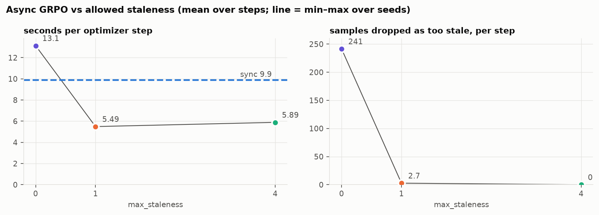

# Async vs sync GRPO

**Async GRPO matched sync GRPO's GSM8K accuracy (0.724 vs 0.732, ±0.020) in ~40% less wall-clock (28–30 vs 49 min
for 300 steps). Allowing one step of staleness gave the whole speed-up; more changed nothing.**

Setup: Qwen3-0.6B, GSM8K, TRL 1.18.2 `GRPOTrainer` vs `AsyncGRPOTrainer`, 2 × GH200 (vLLM on one, trainer on the
other), 2 seeds per config, 17.2 GPU-hours in total.

## Results

| config | final eval acc | s / step | wall-clock, 300 steps |
|---|---|---|---|
| sync | 0.732 | 9.9 | 49.3 min |
| async, `max_staleness=0` | 0.599* | 13.1 | 65.4 min |
| async, `max_staleness=1` | 0.724 | 5.5 | 27.5 min |
| async, `max_staleness=4` | 0.724 | 5.9 | 29.5 min |

Mean of 2 seeds. Eval: 500 held-out GSM8K problems, greedy decoding; the base model scores 0.598.
\*One seed's completions blew up in length late in training. Full table with ranges, best accuracy and
time-to-target: [`results/m3/summary.md`](results/m3/summary.md).


- **Async is faster at the same accuracy.** Generation and training overlap, so vLLM GPU utilisation rises from
  20% to 68%.
- **One step of staleness is enough.** `max_staleness=0` is *slower* than sync, because TRL discards everything
  generated before the latest weight update (~241 samples per step). At `max_staleness=4`, samples were never more
  than 3 steps stale, and speed and accuracy were the same as at 1.



These match published one-step-lag results: ~40% faster in
[Asynchronous RLHF](https://arxiv.org/abs/2410.18252) and 23–40% in
[verl's one-step-off recipe](https://verl.readthedocs.io/en/latest/advance/one_step_off.html).

## What was not done

The SPEC also asked whether a controller that adjusts `max_staleness` during a run could beat the best fixed
setting. **This was not tested.** Every setting of 1 or more performed the same, so there was nothing for a
controller to improve on. A controller is implemented and unit-tested (`src/controller.py`), but it was never
used in a training run. See [`docs/decisions.md`](docs/decisions.md).

## Limitations

- Small: a 0.6B model, 300 steps, 512-token completions, 2 seeds, eval every 50 steps.
- Completion length blew up after step ~250 in 2 of 8 runs (sync seed 1 and async `max_staleness=0` seed 1). Both
  were on-policy runs.
- The two TRL trainers differ in ways TRL builds in, such as dropping zero-advantage groups and batching by token
  budget. This compares the trainers as shipped, configured to be as alike as possible
  ([`docs/notes.md`](docs/notes.md)).

## Reproduce

```bash
cp slurm/env.example.sh slurm/env.sh       # set paths; export SBATCH_ACCOUNT in your shell
sbatch slurm/setup_env.sh                  # build the environment
sbatch slurm/smoke.sh                      # quick check
bash slurm/sweep.sh "0 1"                  # sync, async-s1, async-s4 x 2 seeds
sbatch slurm/async-s0.sh 0; sbatch slurm/async-s0.sh 1
python analysis/plots.py --runs results/logs --out results/m3
```

Environment notes for GH200 / Isambard-AI: [`docs/setup.md`](docs/setup.md). Tests run without a GPU: `pytest`.
